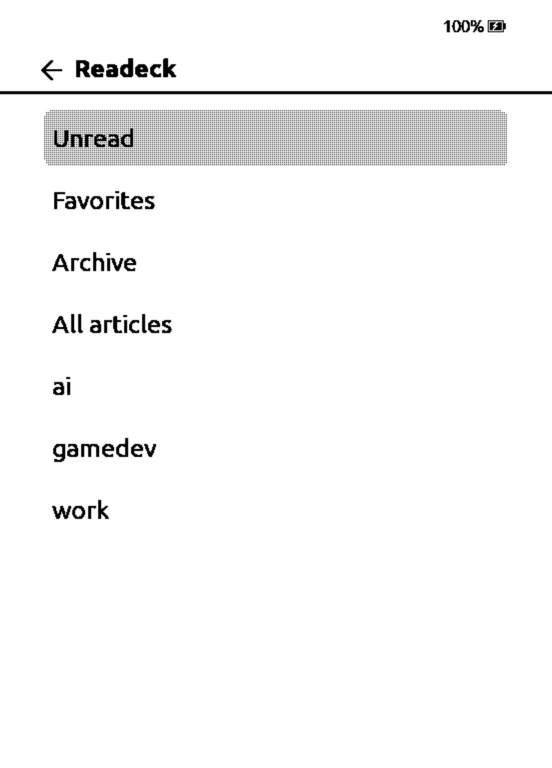
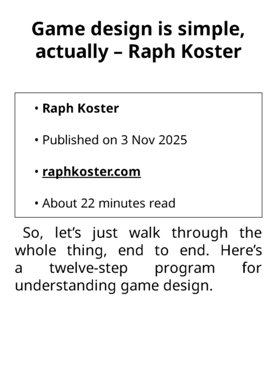
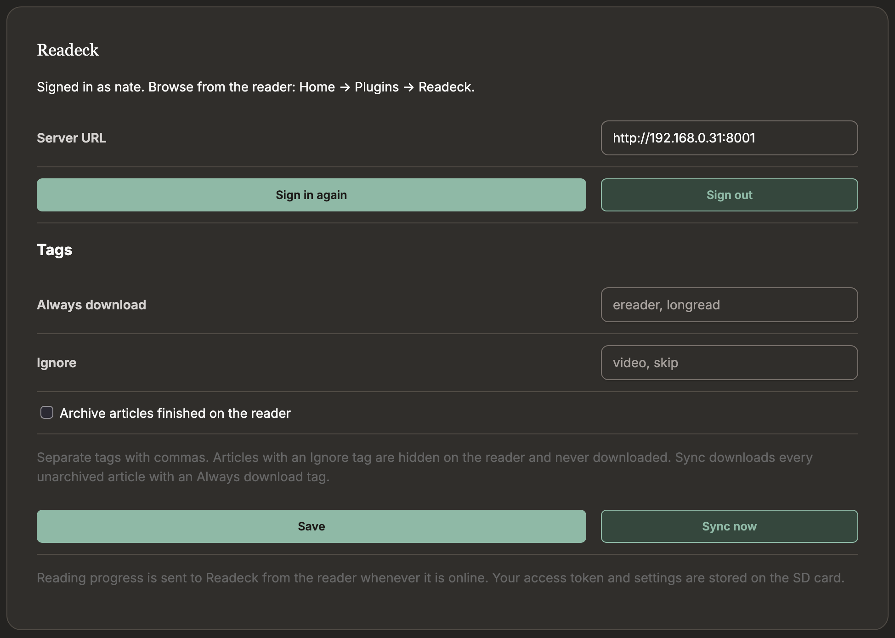

# Readeck CrossPoint Plugin

This is a [Readeck](https://readeck.org/) plugin for the [CrossPoint](https://crosspointreader.com/) e-reader firmware.

It lets you browse and download articles from Readeck and set up a list of tags to sync.

Progress on articles is automatically synced back to Readeck when joining WiFi or putting the device to sleep.
Highlights are sent when syncing from the plugin settings.







## Installing in CrossPoint

### From the CrossPoint Plugin Hub

- To enable the Plugin Hub
  - Settings -> Connectivity -> Plugins -> Enabled
  - On the home page, you'll see "Plugins"
- Go to Plugins -> Plugin Hub
- Select WiFi Network
- Find Readeck

### Manually via SD Card

- Download `readeck.zip` from the latest release
- Unzip it into the `/plugins/` folder on the SD card, so you have `/plugins/readeck/`
- Enable plugins under Settings -> Connectivity -> Plugins
- Restart your e-reader

## Accessing plugin settings

- Make sure you're on the same Wi-fi network as the e-reader
- From the home screen, choose File transfer -> Join Network
- Go to the URL that is displayed
- Select "Plugins"
- Scroll down to find Readeck

## Authenticating to Readeck

- Go to the plugin settings
- Enter your Readeck URL and click "Sign in"
- You will see a link to `/device` on your Readeck instance as well as a code
- Paste the code into Readeck and then select "Authorize"

## Downloading articles from Readeck

### Browsing for articles

On the home page, select Plugins -> Readeck then select a WiFi network.

Browse for articles and select them to download them.

Downloaded articles will be placed in the `Readeck` folder at the root of the SD card.

### Downloading all articles with a tag

- Go to the plugin settings
- Put in a comma-separated list of tags to always download
  - Archived articles are ignored
- Any articles that also have a tag in the "Ignore" list will be ignored
- Click "Sync now"

**Note:** This syncing will only be done when the "Sync now" button is clicked

## Building from source

This plugin is built using [rollup](https://rollupjs.org/). `node` is required to build it.

- `npm install` to install dependencies
- `npm run build` to build the plugin into the `readeck.crosspoint-plugin/` directory
- `npm run test` to run tests
- `npm run format` to format everything
- `npm run package` to build a `.zip` with the plugin (Git ignored)

Plugin code is located in `src/`

## Releasing

Bump the version in `package.json`:

```sh
npm version patch
```

This version is used in the built plugin. Running this will also re-build the plugin folder.

Push the new tag:

```sh
git push --follow-tags
```

Generate the release `.zip`:

```sh
npm run pacakge
```

Create a release on GitHub:

```sh
gh release create v0.1.1 readeck.zip --title "0.1.1" --generate-notes
```
